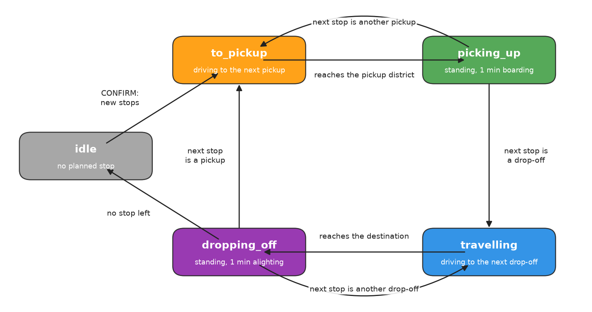
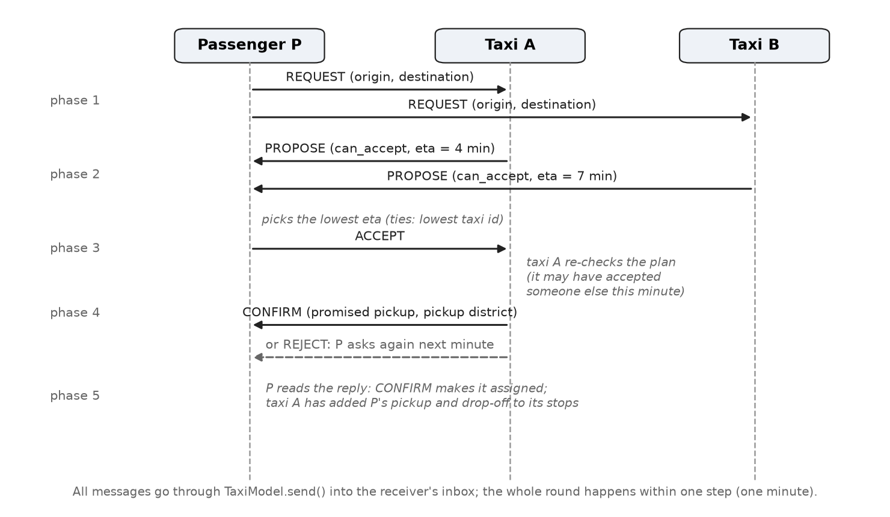
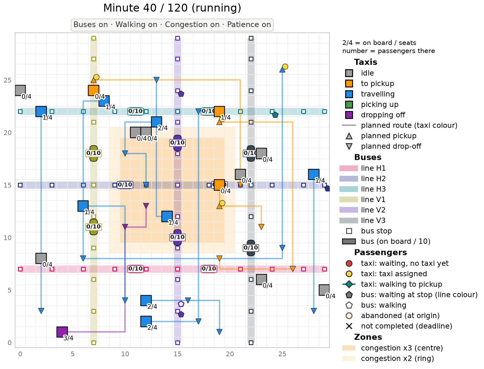
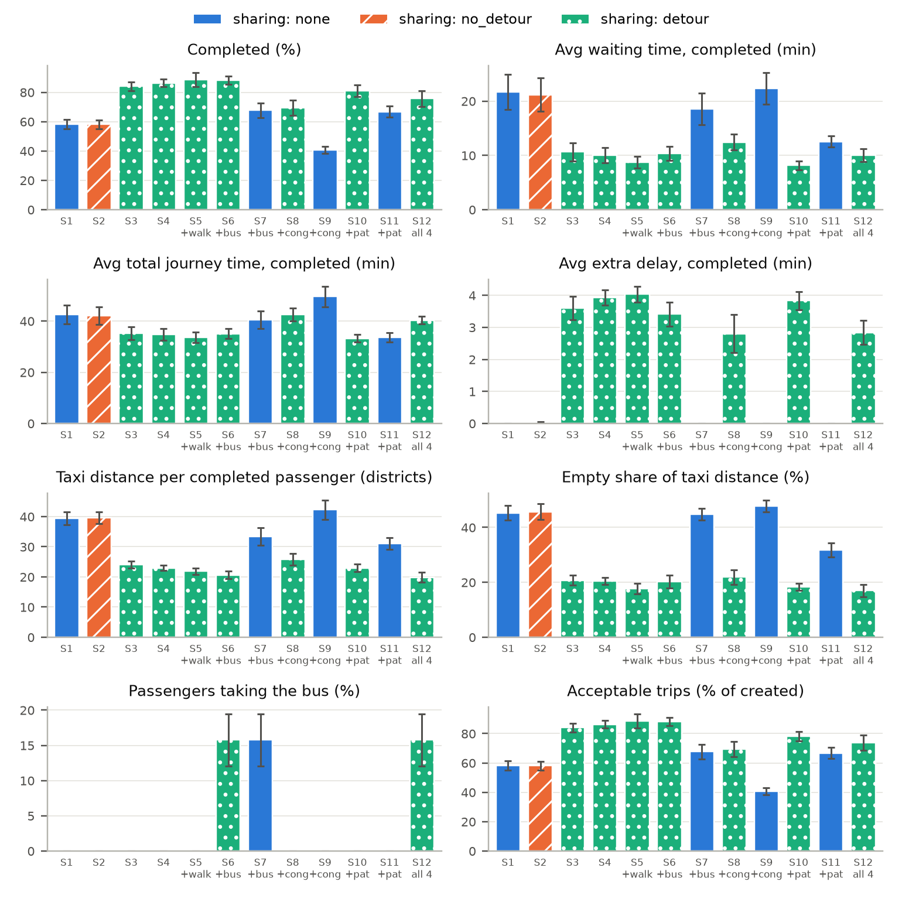
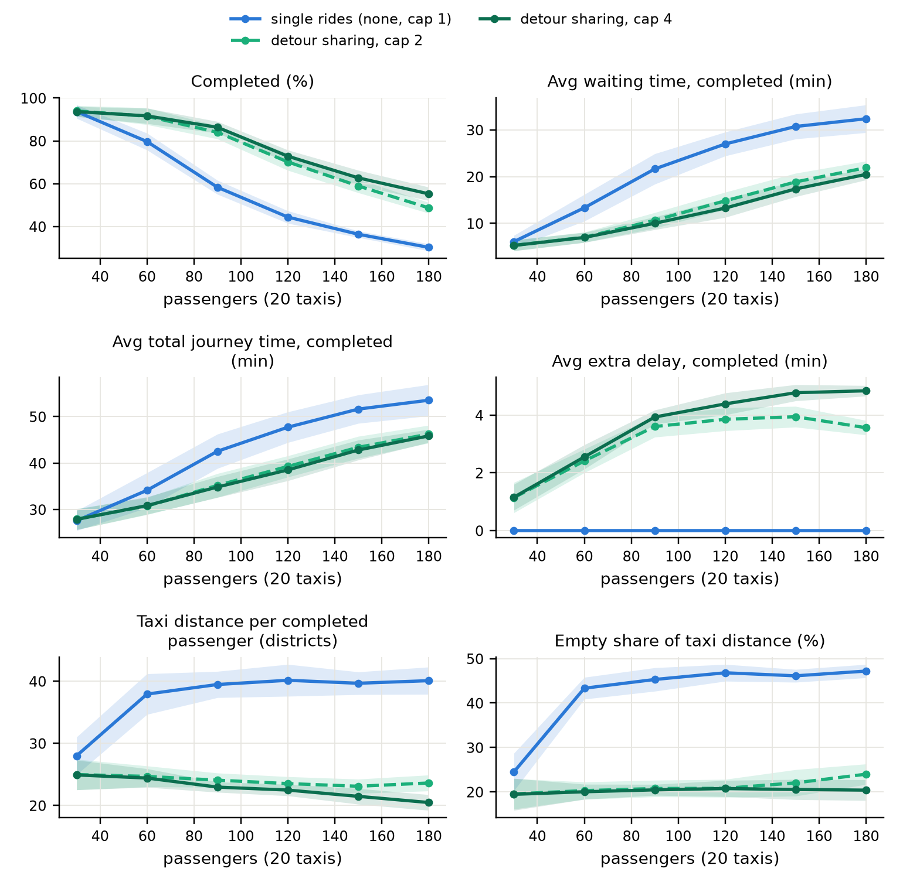
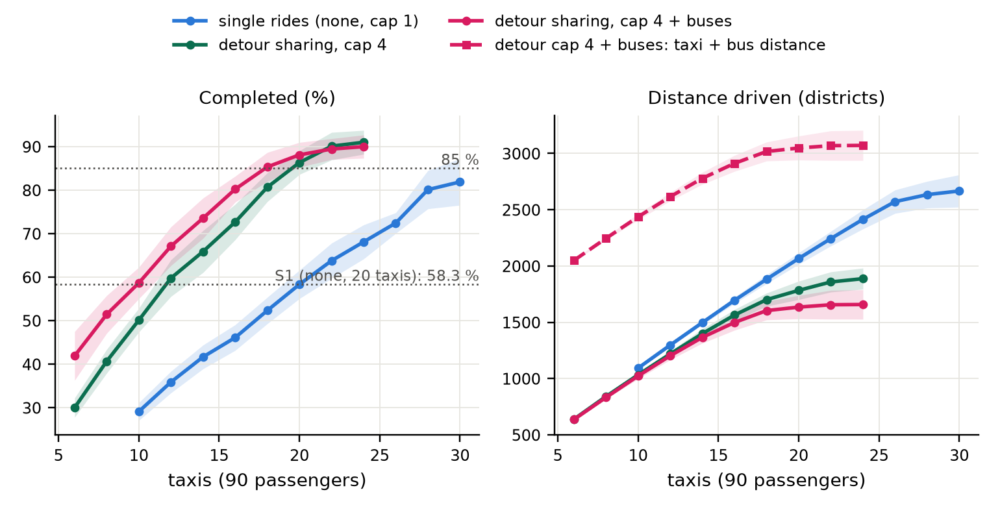

<h1>Taxi sharing in the city: a multi-agent simulation with Mesa</h1>

Ridha LEZZAR and King Korter

Foundations of Agent-based Systems — M1 DKAI, Université Paris-Saclay — teacher: Nicolas Sabouret — 31 October 2026

**Abstract.** We model a city of 30x30 districts in which passengers call taxis through a Contract-Net-like auction and taxis may share rides under a fixed 10-minute extra-delay limit. Following the incremental method of the course, sharing is built in four stages (single rides, sharing on the planned route, sharing with detours for 2 and for 4 seats) and then extended with walking, buses, congestion and passenger patience. Over 10 seeds, detour sharing serves 86.3 ± 2.7 % of passengers against 58.3 ± 3.3 % for single rides with the same 20 taxis, halves the waiting time, and gives the same service as single rides with 12 instead of 20 taxis and 41.0 % less driving. Buses relieve the taxis but, at this demand, increase the total vehicle distance.

## 1. Introduction

Taxis in a city drive many kilometres empty, on the way to their next passenger. Ride sharing lets one taxi carry several passengers whose trips overlap, which can serve more people with fewer vehicles, at the price of detours for those already on board. Our research question is: **how does taxi sharing affect the number of passengers served, passenger waiting times, journey times, and taxi distance travelled under different simulation configurations?** An agent-based model fits this question: each taxi decides locally whether it can take a passenger, each passenger chooses among offers, and the outcome (who is served, how long they wait, how much is driven) emerges from these local decisions and the messages between agents.

## 2. Model design

**Environment.** The city is a Mesa `MultiGrid` of 30x30 cells; each cell is a district and several agents can share a cell. A grid is the simplest space in which distances, routes and congestion have a clear meaning, and 30x30 is large enough that trips vary (1 to 58 districts) while a run stays fast. One simulation step is one minute, so every duration (driving, boarding, waiting, walking) is a whole number of steps and estimates can be exact. A run lasts 120 minutes; passengers appear uniformly during the first 90 minutes, which leaves 30 minutes to finish late trips. Taxis drive the shortest Manhattan path, always **x first, then y**: this deterministic route makes plans reproducible and lets a taxi know exactly which cells it will pass, which the second sharing stage needs.

**Agents.** `TaxiAgent`, `PassengerAgent` and (with buses) `BusAgent` subclass `mesa.Agent`. A taxi holds its position, capacity, passengers on board, an ordered list of stops (pickup or drop-off of a passenger), the pickup times it has promised, and its state (Figure 1). A passenger holds its origin, destination, request minute, status (waiting, assigned, travelling, completed, not completed, abandoned) and the times needed for the metrics.

<figure><figcaption>Figure 1 — Taxi states. A taxi becomes busy when a CONFIRM adds stops; the state always follows the kind of its next stop. Standing at a stop takes the boarding time (1 minute).</figcaption></figure>

**Interaction protocol.** Mesa schedules agents but has no messaging, so we wrote a small `Message` class (sender, receiver, type, data, minute) delivered by `TaxiModel.send()` into the receiver's inbox. Assignment follows the Contract Net Protocol (Figure 2): a waiting passenger broadcasts a **REQUEST** (call for proposals); every taxi answers **PROPOSE** with whether it can accept and its estimated pickup time; the passenger sends **ACCEPT** to the earliest offer; the taxi re-checks its plan, since it may have accepted someone else in the same minute, and answers **CONFIRM** (with the promised pickup minute) or **REJECT**, after which the passenger asks again the next minute. We chose this protocol because it keeps decisions local (no central dispatcher), it is the classic agent negotiation scheme of the course, and its message count is a measurable cost.

<figure><figcaption>Figure 2 — One auction round (one minute) between a passenger and two taxis.</figcaption></figure>

**Step phases.** Each step runs fixed phases with Mesa's `AgentSet.do()` on `model.agents_by_type`: (0) new passengers are created; (1) waiting passengers send REQUEST; (2) taxis PROPOSE; (3) passengers ACCEPT; (4) taxis CONFIRM or REJECT; (5) passengers read replies and walk if needed; (6) taxis, then buses, drive one minute or stand at a stop; (7) the clock advances, impatient passengers abandon, and at minute 120 every unfinished passenger becomes *not completed*. Phases make the order of decisions explicit and the runs deterministic for a given seed.

## 3. Sharing rules, built in four stages

As asked, sharing was built incrementally; each stage is a value of the `sharing_mode` parameter and is kept in the final model so that the stages can be compared (scenarios S1-S4):

| Stage | Mode, capacity | Rule | Why this step |
|---|---|---|---|
| 1 | `none`, 1 | only an idle taxi accepts; one passenger at a time | baseline without sharing |
| 2 | `no_detour`, 2 | a busy taxi also accepts if the new pickup and destination lie, in order, on its planned route | sharing without any detour |
| 3 | `detour`, 2 | general insertion of the new pickup and drop-off into the stop list | route changes allowed |
| 4 | `detour`, 4 | the same with up to 4 passengers | several passengers |

**Insertion search.** For a new passenger the taxi tries every pair of positions (i ≤ j) of its stop list for the pickup and the drop-off, keeping existing stops in order, and keeps the feasible plan with the earliest pickup, then the earliest finish. With n stops there are (n+1)(n+2)/2 plans, each checked in O(n). We do not reorder existing stops: it keeps the search small, and it keeps the promises made to passengers already booked.

**Acceptability.** A plan is feasible only if capacity is never exceeded, every drop-off follows its pickup, and **every** passenger on board or booked keeps an *extra delay* (in-vehicle time minus its direct solo trip time) of at most **10 minutes**. The limit is fixed in every experiment so that results stay comparable: it is the passengers' guarantee, not a parameter we tune. A second rule, the **promise rule**, forbids moving an assigned passenger's pickup more than 10 minutes past the minute promised in its CONFIRM, counted from the original promise so that several insertions cannot add up. Planning uses exactly the costs of the movement (district costs along the x-first path plus boarding), so estimates equal actual times and the limits hold in the simulation, not only in the plan.

**Other choices.** Each pickup and drop-off takes a **boarding time** of 1 minute: without it, extra stops would be free and sharing would look better than it is. A taxi takes on at most **2 x capacity** passengers at a time (on board plus booked): without this booking limit one taxi could queue many passengers far in the future and the search would grow quickly. Assignment is greedy, one auction per minute, with no reassignment after CONFIRM: simple, decentralised and deterministic.

## 4. Extensions

Each extension is an on/off feature, so its effect can be isolated (S5-S12); each is deliberately simple. Table 1 summarises all design choices.

- **Walking.** A taxi may also offer a pickup in a district adjacent to the origin, if the passenger (3 minutes per district) gets there before the taxi, so no taxi ever waits for a walker. Ties go to not walking. The walk counts in the waiting time but not in the extra delay (it is the passenger's choice).
- **Buses.** Three horizontal and three vertical lines (rows and columns 7, 15 and 22), stops every 3 districts, 2 buses per line with 10 seats, driving back and forth at taxi speed. A passenger takes the bus, once and for good, if its trip is at least 6 districts long and one line has stops within 3 districts of both ends; otherwise it calls a taxi. No transfers. This is a fixed mode-choice rule, not a cost-based choice.
- **Congestion.** The central 10x10 districts cost 3 minutes to enter, the ring around them 2, other districts 1; costs stay whole minutes. Taxis and buses are slowed, routes do not avoid congestion, and planning uses the same costs, so estimates stay exact.
- **Patience.** Each passenger draws a patience of 10-30 minutes (from its own random generator, so demand is unchanged), ignores offers whose pickup would come later, and abandons if still unconfirmed when its patience runs out. A confirmed passenger never abandons.

**Table 1** — Design choices at a glance.

| Choice | Why | Simplification accepted |
|---|---|---|
| Cell = district, 30x30 `MultiGrid` | distances and zones are well defined; trips of very different lengths | no road network |
| 1 step = 1 minute, integer costs | every duration is a whole number of steps, so plans can be exact | speeds and dwell times are multiples of a minute |
| x-first Manhattan route | deterministic, shortest, known cell by cell (needed by stage 2) | routes never avoid congestion |
| Contract Net (REQUEST ... CONFIRM) with our `Message` class | local decisions, no central dispatcher, measurable communication cost | one greedy round per minute, no reassignment |
| Insertion without reordering | small search; earlier promises are kept | can miss better plans that reorder stops |
| Fixed 10-minute extra-delay limit + promise rule | a guarantee for every passenger, the same in every run | one limit for everyone |
| Booking limit 2 x capacity | keeps stop lists and the search small | a practical bound, not a modelling result |
| 1-minute boarding at every stop | extra stops must cost something | the same time for everyone |
| Separate seeded generators (demand, fleet, patience) | every scenario sees the same passengers: paired comparisons | one demand pattern per seed |
| One `metrics.py` for model, dashboard and experiments | the numbers shown and the numbers reported are the same | — |
| Features as on/off switches | each effect can be isolated against S1 or S4 | each feature is deliberately minimal |

## 5. Implementation and verification

The model uses Mesa 3.5.1 throughout: `mesa.Agent` subclasses, a `MultiGrid`, `AgentSet.do` phases, a `DataCollector` (model metrics and one row per passenger), `batch_run` for the experiments and a `SolaraViz` dashboard (Figure 3). The code is split by concern: `config.py` (fixed settings), `messages.py`, `routing.py` (paths, congestion), `agents.py` (taxi and passenger behaviour), `buses.py`, `model.py` (phases, demand, deadline), `metrics.py` (one definition used by the model, the dashboard and the experiments), `app.py` (dashboard) and `run_experiments.py` (scenarios from a CSV file, results and charts). Installation and run instructions are in `README.md`.

The **149 pytest tests** check: hand-computed scenarios (pickup and arrival minutes of single and shared trips, accepted and rejected insertions, the promise rule); invariants after every step of random runs in every mode (capacity, drop-off after pickup, extra delay and promise slips at most 10 minutes, consistent status counts, bus capacity, walkers present when picked up); exact estimates under congestion; that every feature switched off reproduces the stored S1-S4 results exactly; and the dashboard drawing for all 16 feature combinations.

## 6. Experimental setup

All runs use the fixed settings of Section 2 (30x30, 120 minutes, arrivals over 90 minutes, 1 minute per district, 1 minute of boarding, extra-delay limit 10 minutes). The base fleet and demand, **20 taxis and 90 passengers**, were calibrated by trying several combinations so that single rides serve a medium share of passengers (S1: 58.3 ± 3.3 %), leaving room to see both gains and losses. The 12 scenarios are: S1-S4 the four sharing stages; S5, S6, S8, S10 add walking, buses, congestion and patience to S4; S7, S9, S11 add buses, congestion and patience to S1; S12 has all four. Each runs with seeds 1-10; demand and taxi start cells depend only on the seed, so every scenario sees exactly the same passengers. Two further sets vary the load (20 taxis, 30 to 180 passengers) and the fleet (90 passengers, 6 to 30 taxis). We report mean ± standard deviation over the 10 seeds.

<figure><figcaption>Figure 3 — Dashboard map of S12 (all four features) at minute 40, seed 1 (as <code>docs/map_S12.png</code>, drawn at page size): taxis by state with "on board / seats", planned routes and stops, bus lines and buses, passengers, congestion zones.</figcaption></figure>

## 7. Results

**Table 2** — Scenarios S1-S12 (mean ± std, seeds 1-10). Times are over completed passengers; extra delay over taxi passengers; distance in districts.

| | Features | Completed % | Wait (min) | Total time (min) | Extra delay (min) | Taxi dist. / completed | Empty % | Bus % | Acceptable % |
|---|---|---|---|---|---|---|---|---|---|
| S1 | none, cap 1 | 58.3 ± 3.3 | 21.6 ± 3.3 | 42.5 ± 3.7 | 0.0 ± 0.0 | 39.5 ± 2.1 | 45.3 ± 2.6 | 0.0 ± 0.0 | 58.3 ± 3.3 |
| S2 | no_detour, cap 2 | 58.1 ± 2.9 | 21.2 ± 3.1 | 42.1 ± 3.4 | 0.0 ± 0.0 | 39.6 ± 2.0 | 45.7 ± 2.9 | 0.0 ± 0.0 | 58.1 ± 2.9 |
| S3 | detour, cap 2 | 84.0 ± 3.1 | 10.6 ± 1.7 | 35.2 ± 2.6 | 3.6 ± 0.4 | 24.1 ± 1.2 | 20.8 ± 1.9 | 0.0 ± 0.0 | 84.0 ± 3.1 |
| S4 | detour, cap 4 | 86.3 ± 2.7 | 10.0 ± 1.4 | 34.8 ± 2.3 | 3.9 ± 0.2 | 23.0 ± 0.8 | 20.5 ± 1.2 | 0.0 ± 0.0 | 86.3 ± 2.7 |
| S5 | S4 + walking | 88.7 ± 4.9 | 8.7 ± 1.1 | 33.6 ± 2.0 | 4.0 ± 0.3 | 21.9 ± 1.1 | 17.6 ± 1.9 | 0.0 ± 0.0 | 88.7 ± 4.9 |
| S6 | S4 + buses | 88.1 ± 2.9 | 10.4 ± 1.3 | 35.1 ± 2.0 | 3.4 ± 0.4 | 20.6 ± 1.3 | 20.3 ± 2.3 | 15.8 ± 3.7 | 88.1 ± 2.9 |
| S7 | S1 + buses | 67.7 ± 5.0 | 18.6 ± 2.9 | 40.5 ± 3.4 | 0.0 ± 0.0 | 33.4 ± 2.9 | 44.8 ± 2.2 | 15.8 ± 3.7 | 67.7 ± 5.0 |
| S8 | S4 + congestion | 69.4 ± 5.0 | 12.4 ± 1.4 | 42.6 ± 2.5 | 2.8 ± 0.6 | 25.7 ± 1.9 | 21.9 ± 2.7 | 0.0 ± 0.0 | 69.4 ± 5.0 |
| S9 | S1 + congestion | 40.8 ± 2.4 | 22.4 ± 2.9 | 49.6 ± 4.1 | 0.0 ± 0.0 | 42.3 ± 3.2 | 47.8 ± 2.2 | 0.0 ± 0.0 | 40.8 ± 2.4 |
| S10 | S4 + patience | 81.0 ± 3.9 | 8.1 ± 0.8 | 33.2 ± 1.5 | 3.8 ± 0.3 | 22.9 ± 1.3 | 18.4 ± 1.3 | 0.0 ± 0.0 | 78.1 ± 3.1 |
| S11 | S1 + patience | 66.8 ± 3.8 | 12.6 ± 1.0 | 33.6 ± 1.9 | 0.0 ± 0.0 | 31.0 ± 1.9 | 31.8 ± 2.5 | 0.0 ± 0.0 | 66.8 ± 3.8 |
| S12 | S4 + all four | 75.8 ± 5.4 | 10.0 ± 1.2 | 40.3 ± 1.5 | 2.8 ± 0.4 | 19.9 ± 1.7 | 17.0 ± 2.3 | 15.8 ± 3.7 | 73.8 ± 5.1 |

<figure><figcaption>Figure 4 — S1-S12 compared (results/charts/comparison.png laid out for the page; mean over seeds 1-10, error bars ± 1 std). Colour and hatching give the sharing mode, the tag under each id the features switched on.</figcaption></figure>

**Table 3** — Smallest fleet reaching the S1 level (58.3 %) or 85 % completed, with 90 passengers. Vehicle distance = taxi + bus districts, summed per run. Single rides never reach 85 %: their row shows the largest fleet tried (30 taxis).

| Mode | Target | Taxis | Completed % | Taxi distance | Bus distance | Vehicle distance | Empty taxi % |
|---|---|---|---|---|---|---|---|
| none, cap 1 | S1 level | 20 | 58.3 ± 3.3 | 2066.9 ± 51.1 | 0 | 2066.9 ± 51.1 | 45.3 ± 2.6 |
| detour, cap 4 | S1 level | 12 | 59.8 ± 4.2 | 1219.1 ± 23.9 | 0 | 1219.1 ± 23.9 | 24.0 ± 3.3 |
| detour, cap 4 + buses | S1 level | 10 | 58.7 ± 3.6 | 1023.2 ± 26.3 | 1413.6 ± 5.5 | 2436.8 ± 27.7 | 25.4 ± 3.5 |
| none, cap 1 | 85 % | not reached (30) | 81.9 ± 5.4 | 2666.8 ± 143.6 | 0 | 2666.8 ± 143.6 | 39.6 ± 3.8 |
| detour, cap 4 | 85 % | 20 | 86.3 ± 2.7 | 1783.7 ± 81.8 | 0 | 1783.7 ± 81.8 | 20.5 ± 1.2 |
| detour, cap 4 + buses | 85 % | 18 | 85.3 ± 3.3 | 1604.0 ± 82.3 | 1413.6 ± 5.5 | 3017.6 ± 84.4 | 22.0 ± 3.0 |

<figure><figcaption>Figure 5 — Load sweep with 20 taxis (results_analysis/sweep.png laid out for the page): single rides vs detour sharing with 2 and 4 seats (line: mean over seeds 1-10; band: ± 1 std).</figcaption></figure>

<figure><figcaption>Figure 6 — Completed % and distance driven against fleet size, 90 passengers (results_analysis/fleet.png laid out for the page). Solid lines: taxi distance; dashed line: taxi + bus distance of the bus mode.</figcaption></figure>

## 8. Discussion

**Number served and traffic.** Detour sharing is the decisive step: with the same 20 taxis it serves 86.3 ± 2.7 % of passengers against 58.3 ± 3.3 % for single rides (Table 2, Figure 4). The gain is largest at medium to high load and vanishes at low load: with 30 passengers both serve almost everyone (93.7 ± 2.3 % and 93.7 ± 3.1 %, Figure 5). Seen from the fleet side (Table 3, Figure 6), sharing gives the S1 level of service with 12 taxis instead of 20, cutting driving from 2066.9 ± 51.1 to 1219.1 ± 23.9 districts (-41.0 %) and the empty share from 45.3 ± 2.6 % to 24.0 ± 3.3 %; 85 % is reached with 20 shared taxis but not with 30 unshared ones. Capacity 4 adds little over 2 (86.3 ± 2.7 % vs 84.0 ± 3.1 %): with 1-minute stops, every extra rider delays the others and the 10-minute limit blocks most third and fourth riders.

**Stage 2 is useless on random trips.** Two random trips rarely lie, in order, on the same x-first route, so with `no_detour` only 1.5 ± 1.5 completed passengers per run shared a ride (61.4 ± 4.3 with stage 3), and it performs like single rides (58.1 ± 2.9 %). Sharing needs detours.

**Travel time: waiting against riding.** At the base load, sharing halves the wait (10.0 ± 1.4 vs 21.6 ± 3.3 min) and lengthens the ride (in-vehicle 24.8 ± 1.1 vs 20.9 ± 0.9 min; extra delay 3.9 ± 0.2), so the whole journey is shorter (34.8 ± 2.3 vs 42.5 ± 3.7 min, with 86.3 ± 2.7 % and 58.3 ± 3.3 % completed). Extra delay grows with load (1.2 ± 0.4 min at 30 passengers, 4.8 ± 0.2 at 180) but stays far below the limit; the largest extra delay ever observed is exactly the 10-minute limit.

**Acceptability and patience.** By construction no passenger suffers more than 10 minutes of extra delay and no promise slips by more than 10 minutes. With patience, 26.7 ± 3.2 % of passengers abandon without sharing (S11) and 10.8 ± 4.4 % with sharing (S10). Abandoning passengers never held a taxi, so abandoning itself frees nothing; the effect comes from the offers passengers refuse. With patience a passenger ignores any offer whose pickup would come after its patience runs out, so idle taxis are no longer sent on long empty drives to far-away passengers. Without sharing this is a large gain: the empty share falls from 45.3 ± 2.6 % (S1) to 31.8 ± 2.5 % (S11), taxi distance per completed passenger from 39.5 ± 2.1 to 31.0 ± 1.9 districts, and completion rises from 58.3 ± 3.3 % to 66.8 ± 3.8 %. With sharing, almost every passenger is confirmed in its first round anyway, so patience only removes passengers whose offers came too late: completion falls from 86.3 ± 2.7 % (S4) to 81.0 ± 3.9 % (S10), and acceptable trips to 78.1 ± 3.1 %.

**The other features.** Walking helps a little (S5: 88.7 ± 4.9 % completed, wait 8.7 ± 1.1 min, empty share 17.6 ± 1.9 %). Congestion is the largest loss (S8: 69.4 ± 5.0 %, S9: 40.8 ± 2.4 %), and sharing keeps more of its service than single rides. Buses take 15.8 ± 3.7 % of passengers and relieve the taxis, most clearly without sharing (S7: 67.7 ± 5.0 % vs 58.3 ± 3.3 %). Bus riders wait longer than taxi riders (19.0 ± 2.6 vs 8.8 ± 1.5 min in S6, the walk to the stop included). **But buses do not reduce driving at this demand.** They drive their full lines carrying only 0.13 ± 0.03 passengers per district: in S6 the taxis drive 1634.9 ± 103.7 districts and the buses 1413.6 ± 5.5, a total of 3048.5 ± 106.8 against 1783.7 ± 81.8 in S4; for the S1 level of service, sharing with buses drives 2436.8 ± 27.7 vehicle districts, more than single rides. A bus is also a bigger vehicle than a car, so bus distance is not comparable to car distance for pollution; our distances are proxies for vehicle movements only.

**Communication cost.** Messages show the price of the decentralised protocol. With sharing, every passenger is confirmed in its first round: S4 sends 3780.0 ± 0.0 messages per run, exactly 90 × (20 REQUEST + 20 PROPOSE + 1 ACCEPT + 1 CONFIRM), i.e. 48.7 ± 1.6 per completed passenger. Without sharing, busy taxis refuse and waiting passengers broadcast again every minute: 1511.7 ± 213.8 messages per completed passenger in S1.

## 9. Limitations and future work

The city is an abstract grid without road network or traffic from other vehicles; congestion is a fixed pattern that routes do not avoid. Assignment is a greedy one-round auction without reassignment, insertion never reorders existing stops, and the booking limit is a practical bound. Boarding time is fixed and idle taxis do not reposition. Walking covers one adjacent district; buses have fixed lines, no transfers and a one-shot, threshold-based mode choice; patience applies only before the CONFIRM. Results depend on the chosen city size, fleet and demand, with 10 seeds per scenario. Natural extensions are congestion-aware routing, reordering of stops, repositioning of idle taxis, reassignment, bus transfers and a cost-based choice between bus and taxi.

## 10. Conclusion

In our model, sharing with detours is what makes taxi sharing work: it serves far more passengers with the same fleet, or the same passengers with 40 % fewer taxis and 41 % less driving, while passengers trade a shorter wait for a few minutes of extra ride, always within the 10-minute guarantee. Sharing only along the planned route almost never happens on random trips. Buses can take part of the demand off the taxis, but at this demand their own driving outweighs the taxi distance they save.
